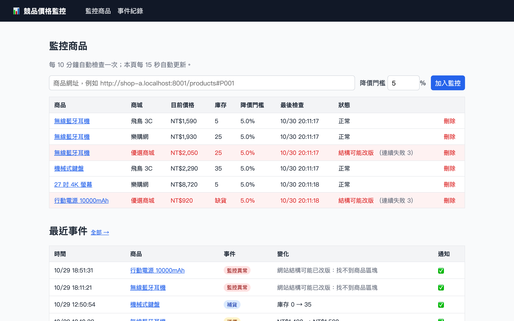
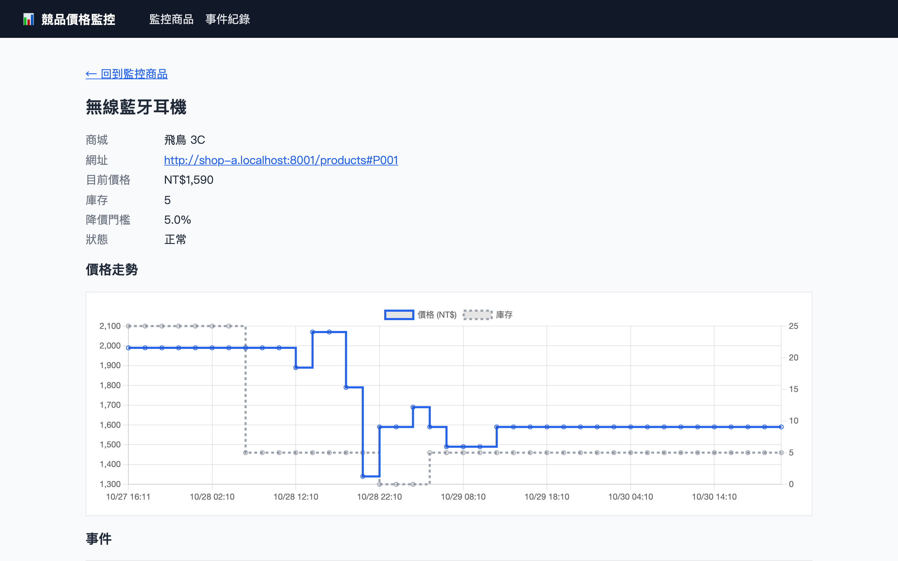
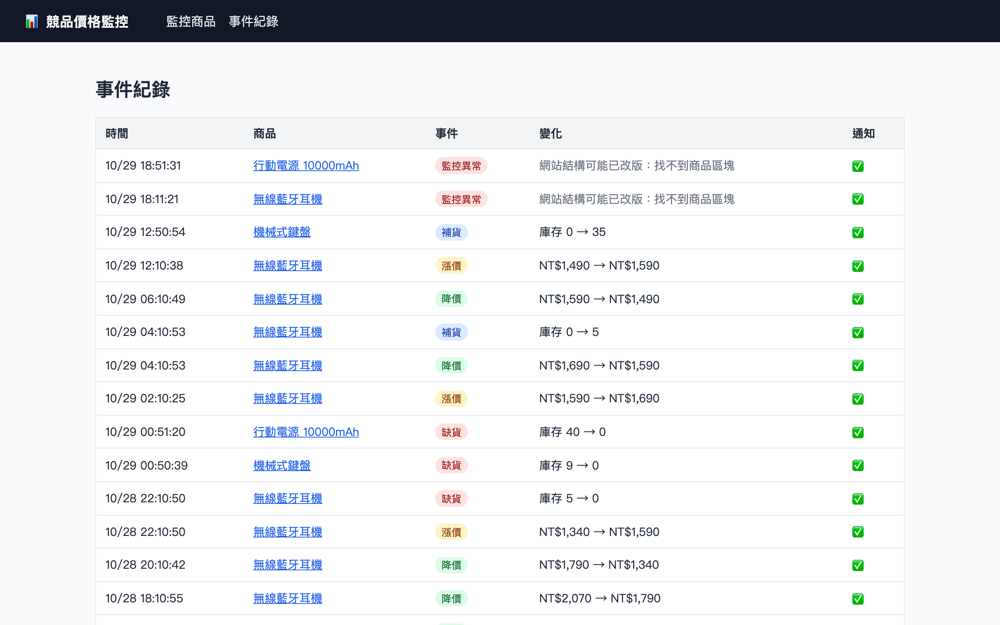

# 競品價格監控與通知

> Code Sky 逅斯蓋工作室｜作品集 01



## 要解決的問題

電商賣家需要隨時掌握競爭對手的價格與庫存。靠人工每天逐一點開商品頁查看，不只費時，對手何時降價、何時缺貨也常常來不及發現。

## 解法

一套 24 小時自動運作的監控系統：

1. **定時爬取**：依你設定的間隔，自動檢查所有監控中的競品商品頁。
2. **偵測變化**：降價或漲價超過你設定的門檻、商品缺貨或補貨時，立即產生事件。
3. **即時通知**：透過 Telegram 或 LINE 推播到你的手機，可以同時啟用多個管道。
4. **網站改版也不會默默失效**：如果競品網站改版，導致系統抓不到價格，會主動發出「監控異常」通知，不會讓你以為一切正常；恢復後也會再通知一次。
5. **已支援真實網站**：除了內附的模擬商城，也能直接監控 PChome 24h 的商品，貼上商品頁網址即可。
6. **儀表板**：在網頁上新增或移除監控商品，查看每個商品的價格走勢與事件紀錄，異常的商品會以紅色標示。

## 成果

以下截圖使用內附的模擬商城資料。

**監控商品**：一眼看出每個競品的目前價格與庫存；抓不到價格的商品以紅色標示，並顯示原因。


**價格走勢**：每個商品都有價格與庫存的歷史圖表，對手何時降價、何時缺貨一目了然。



**事件紀錄**：降價、漲價、缺貨、補貨、監控異常，每個事件都會推播通知並留下紀錄。



Demo 影片：待補

通知範例：

```
📉 降價｜無線藍牙耳機（飛鳥 3C）
NT$1,990 → NT$1,590（-20.1%）

🚨 監控異常｜無線藍牙耳機（優選商城）
連續失敗，請檢查網站是否改版或無法連線
網站結構可能已改版：找不到商品區塊
```

## 自己跑跑看

只需要安裝 Docker：

```bash
cp .env.example .env    # 可選：填入 Telegram / LINE 設定；不填則通知會輸出在終端機
docker compose up
```

- 儀表板：<http://localhost:8000>
- 模擬競品商城：<http://localhost:8001>。系統內附三家 HTML 結構各不相同的模擬商城，價格與庫存會自動變動。
- 監控真實商品：在儀表板貼上 PChome 24h 的商品頁網址，例如 `https://24h.pchome.com.tw/prod/DYAJCH-1900JLHPE`。

本機瀏覽器開啟 `http://shop-a.localhost:8001` 這類網址時，建議使用 Chrome 或 Firefox，這兩個瀏覽器會自動把 `*.localhost` 解析到本機。

想立刻看到效果，不必等排程：

```bash
# 在 .env 設定 SCRAPE_INTERVAL_MINUTES=1，讓系統每分鐘檢查一次

# 隨機變動價格與庫存（也可以在 http://localhost:8001 按按鈕）
curl -X POST localhost:8001/admin/mutate

# 指定某家商城某個商品的價格或庫存
curl -X POST localhost:8001/admin/items/shop-a/P001 \
  -H 'content-type: application/json' -d '{"price": 1590}'

# 模擬網站改版，觀察「監控異常」通知
curl -X POST "localhost:8001/admin/redesign/shop-c?enabled=true"
```

查看終端機通知：`docker compose logs -f monitor`

## 使用的技術

- Python 3.12、FastAPI、SQLAlchemy（SQLite，可換成 PostgreSQL）
- APScheduler 定時排程、httpx + BeautifulSoup 爬取與解析
- Jinja2 + HTMX 伺服器端渲染的儀表板，以 Chart.js 繪製價格走勢
- Telegram Bot API、LINE Messaging API
- Docker Compose 一鍵部署；pytest 自動化測試、ruff 程式碼檢查

架構上，每個監控網站對應一個獨立的解析模組，每種通知管道也是一個獨立模組。要新增監控網站或通知管道（例如 Email、Slack），只需要加一個模組，不必改動其他部分。

## 對應的服務方案

- **定時監控 + 通知**：依你要監控的網站客製爬取模組，設定通知門檻與管道，部署到雲端主機。
- **月費維運**：競品網站改版時，系統會主動通知，我們負責修正解析模組，確保監控不中斷。

## 開發

```bash
uv sync
uv run pytest
uv run ruff check . && uv run ruff format --check .
```

設計文件：[docs/design.md](docs/design.md)
